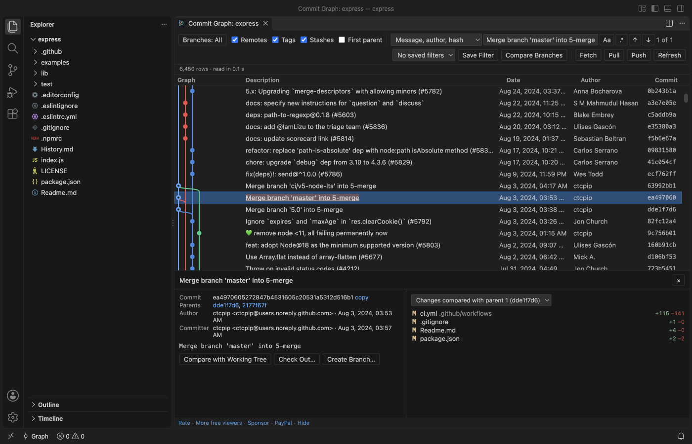
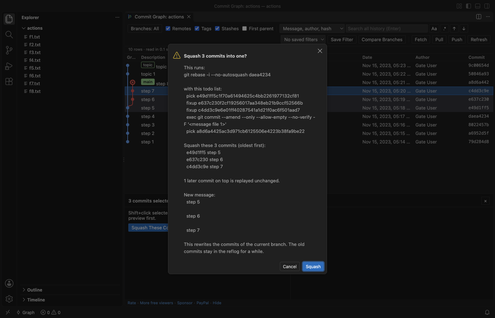

# Git Commit Graph & History Log (Branches, Compare, Blame)

Free, no sign-in, works offline. The extension makes no network calls of its own. Fetch, Pull and Push run your own git, with your own credentials, only when you click them and confirm.

See every branch, tag, remote branch and stash of a repository as one graph, search the whole history, compare any two commits, and run checkout, merge, rebase, cherry-pick, revert, reset and squash with the exact git command shown before anything runs.

## What you get

- The graph: Branches, tags, remotes and stashes as coloured lanes, with a row for uncommitted changes on top. Only the rows on screen are drawn, so 200,000 commits scroll as smoothly as 50.
- Search the full history: Message (the whole message, not only the first line), author, email or hash. Or switch to *File path* (commits that touched `src/parser` or `*.md`), *Changed text* (`git log -S`) or *Changed lines regex* (`git log -G`). Enter and Shift+Enter step through the matches, even when they are far below the screen.
- Commit details: Message, author, committer, parents and the changed files with +/- counts. Click a file for the VS Code diff. Merge commits can be compared with each parent. Open any file as it was at that commit.
- Compare: Ctrl+click (Cmd+click on macOS) a second commit to list the files that differ between the two, or compare a commit with your working tree.
- Actions that ask first: Right-click a commit, branch or tag: check out, create, rename and delete branches and tags, merge (normal, `--no-ff`, `--ff-only`, `--squash`), rebase, cherry-pick, revert, reset (soft, mixed, hard with a warning), stash apply, pop and drop. Each one shows the git command in a confirmation, and nothing runs until you click the button.
- Squash a range: Click the newest commit, Shift+click the oldest, then *Squash These Commits*. The preview lists the commits and the `git rebase -i` todo list; git does the work, so the result is the same as on the command line.
- When git stops: A rebase, merge or cherry-pick that stops on a conflict shows a bar with Continue, Skip and Abort.
- File and line history: *Show File History* follows renames. *Show Line History for Selection* lists the commits that changed the selected lines, with each change inline (the history of those lines' blame).
- Many repositories: Nested repositories and submodules each get an entry in the repository picker.
- Dark and light: Every colour comes from your VS Code theme.

## Why this one

The most installed git graph extension on the Marketplace had its last release on 5 April 2021. Its users ask for these things, and this extension measures them in its test gate on real repositories:

| What users report | Where | Here |
|---|---|---|
| Find only searches the loaded commits ("'Find' doesn't search full log - only what's loaded. That's a dealbreaker") | [Marketplace review, 2025-06-20](https://marketplace.visualstudio.com/items?itemName=mhutchie.git-graph&ssr=false#review-details); [issue #571](https://github.com/mhutchie/vscode-git-graph/issues/571) (branches far apart are not shown); [issue #468](https://github.com/mhutchie/vscode-git-graph/issues/468) (text after a blank line in a message is not found) | The whole history is read (200,000 commits in 2 to 9 s in the gate, first rows in under 2 s). Search found commit 1,234 of 200,000 at row 198,766, far below the screen, and searches the full message with git. |
| No squash ("No commit squashing?") | [Marketplace review, 2025-08-14](https://marketplace.visualstudio.com/items?itemName=mhutchie.git-graph&ssr=false#review-details); [issue #410](https://github.com/mhutchie/vscode-git-graph/issues/410); [issue #182](https://github.com/mhutchie/vscode-git-graph/issues/182) | Squash a range with a preview. In the gate the result had the same trees and author as `git rebase -i` typed in a terminal. |
| Not maintained, broke with a new VS Code ("As of VS Code 1.109 Git Graph does not work anymore") | [Marketplace review, 2026-02-18](https://marketplace.visualstudio.com/items?itemName=mhutchie.git-graph&ssr=false#review-details); [issue #715](https://github.com/mhutchie/vscode-git-graph/issues/715) | Tested in VS Code 1.142 (November 2026). Works from VS Code 1.90, so also in Cursor and Windsurf. |

This extension is not made by, and does not replace, any other publisher's extension. It reads the same git repository, so you can use both.

## Squash with a preview

## Large repositories

Measured in the real VS Code gate on a repository with 200,000 commits on 30 branches (made with git fast-import):

- First rows on screen 490 to 1,860 ms after the load starts, and all 200,000 commits read in 2 to 9 s (five gate runs on a shared Mac, the slower numbers while dozens of other jobs ran).
- Scrolling 2,400 rows in 120 frames: 0 of 120 frames took longer than 50 ms (the longest took 17 ms).
- The history is read in a background thread from a `git log` stream. The extension host only passes messages, and the graph data takes about 61 MB.
- Files bigger than 50 MB at a commit (setting `zovoGit.maxFileMB`) are not loaded into a diff; a short note says why.
- Commits beyond `zovoGit.graph.maxCommits` (500,000 by default) are not drawn; path and changed-text searches still cover the full history.

## Safe by design

- Read commands (the graph, search, details, diffs, history) run git with repository hooks, fsmonitor, external diff, textconv filters, the pager and the clean/smudge filters from the repository's own config turned off, with no optional locks and no download of missing objects. Opening a repository you just cloned cannot run a program from it. The gate checks this with a repository whose hooks, fsmonitor, textconv, external diff, pager and filters would each write a file.
- A branch, tag or remote whose name starts with "-" (git would read it as an option) is refused with a message. Nothing runs.
- Write commands run only after your click in a confirmation that shows the command, and behave like the same command in a terminal (your hooks run, as they would there).
- The extension waits until you trust the folder (Restricted Mode).
- It stores no credentials and has no telemetry.

## Commands

| Command | What it does |
|---|---|
| Commit Graph: Show Commit Graph | Opens the graph (also the Graph button in the status bar and in Source Control) |
| Commit Graph: Search All History | Opens the graph with the search box focused |
| Commit Graph: Show File History | Commits that changed the current file, renames followed |
| Commit Graph: Show Line History for Selection | Commits that changed the selected lines |
| Commit Graph: Go to Commit... | Jumps to a hash, branch, tag or revision |
| Commit Graph: Compare Branches (Report)... | Markdown report: commits on each side, merge base, changed files, authors |
| Commit Graph: Interactive Rebase... | Reorder, reword, squash, fixup and drop commits with drag and drop |

## Settings

`zovoGit.path`, `zovoGit.graph.order` (date or topo), `zovoGit.graph.maxCommits`, `zovoGit.graph.showRemoteBranches`, `zovoGit.graph.showTags`, `zovoGit.graph.showStashes`, `zovoGit.graph.showUncommittedChanges`, `zovoGit.dateFormat`, `zovoGit.maxFileMB`, `zovoGit.maxFilesInDetails`, `zovoGit.detectDepth`, `zovoGit.statusTimeoutSec`, `zovoGit.showStatusBarItem`, `zovoGit.showEditorTitleButton`, `zovoGit.showSupportLinks`, `zovoGit.askForRating`.

## Free

Every feature in this version is free, with no account and no time limit. The branch comparison report, the visual interactive rebase editor and saved filters may become part of Zovo Pro later (USD 19 once, for every Zovo tool). The graph, search, details, diffs, history, squash and every git action stay free.

## Privacy

No network calls, no telemetry, no account. The only state the extension keeps is in VS Code's own storage: saved filters per workspace and whether you answered the rating question.

## Support Zovo

Zovo extensions are free, with no ads and no tracking. They are made by [theluckystrike](https://github.com/theluckystrike) on GitHub. If this one saves you time, you can support the work:

- [Sponsor on GitHub](https://github.com/sponsors/theluckystrike)
- [PayPal](https://www.paypal.com/paypalme/najzzz)
- [Follow theluckystrike on GitHub](https://github.com/theluckystrike)

## More tools by Zovo

- [ZIP Viewer & Archive Explorer (JAR, TAR, GZ)](https://marketplace.visualstudio.com/items?itemName=zovo.zip-archive-explorer) browses ZIP, JAR, VSIX, TAR and GZ files, opens entries in tabs and extracts them safely.
- [Hex Viewer & Binary Viewer, Hex Editor (Large Files)](https://marketplace.visualstudio.com/items?itemName=zovo.zovo-hex-viewer) Hex viewer, binary viewer and hex editor for VS Code that opens files of any size (4 GB and more) in under a second. Insert and delete bytes, compare two files byte by byte, go to offset, find hex or text, a data inspector, copy as C array or base64. Free, works offline.
- [Large JSON Viewer, JSON Browser & JSON Tree](https://marketplace.visualstudio.com/items?itemName=zovo.zovo-json-tree-viewer) shows large JSON files as a searchable tree, copies JSONPath and turns arrays of objects into a table.
- [SQLite Viewer & SQLite3 DB File Browser, Database Explorer](https://marketplace.visualstudio.com/items?itemName=zovo.sqlite-table-viewer) browses SQLite tables read-only and runs SELECT queries.
- [Graphviz Viewer & DOT Viewer (Live Preview)](https://marketplace.visualstudio.com/items?itemName=zovo.zovo-graphviz-preview) shows a live preview of DOT files and exports SVG or PNG.

See [all Zovo extensions on the Marketplace](https://marketplace.visualstudio.com/publishers/zovo).

## More from zovo

- [All free zovo VS Code extensions](https://marketplace.visualstudio.com/publishers/zovo) — file viewers, database clients, formatters. Offline, no telemetry, no sign-up.
- [Full MCP server catalogue](https://theluckystrike.github.io/mcp/) — local-first MCP servers for back-office work: invoices, VAT, PDFs, spreadsheets, payroll.
- [Hosted no-install MCP endpoints](https://mcp.zovo.one) — paste a URL in Claude / Cursor, nothing to install.
